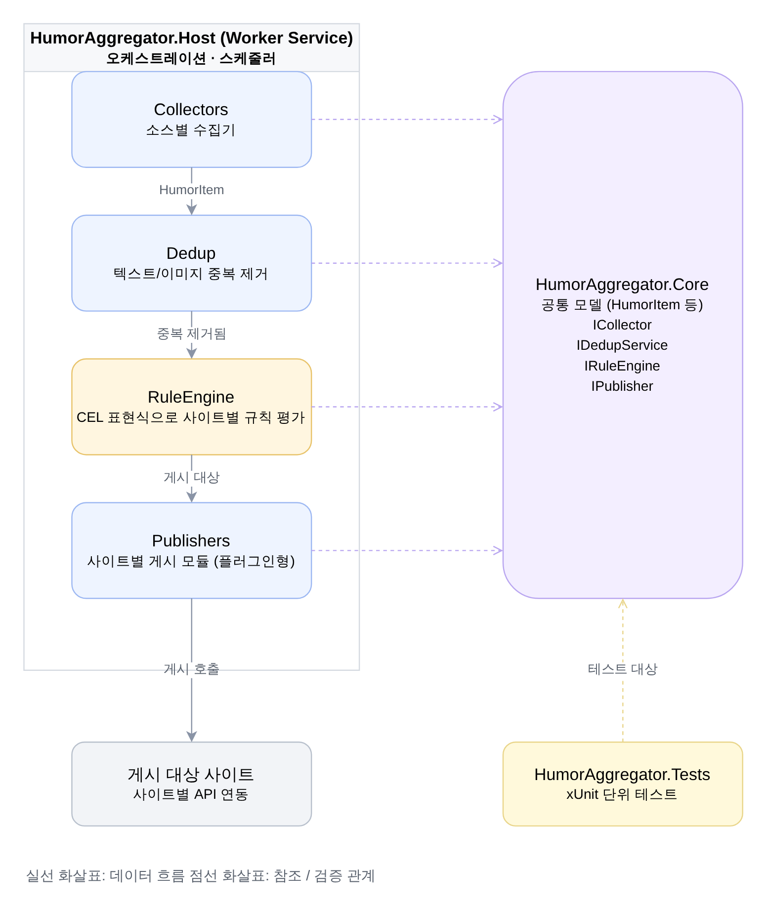

# 아키텍처

원본: [`architecture.drawio`](architecture.drawio)

## 개요

수집된 콘텐츠는 `Collectors → Dedup → RuleEngine → Publishers` 순서로 처리됩니다. 이 파이프라인은 `Host`(.NET Worker Service)가 실행·스케줄링하며, 모든 모듈은 `Core`의 공통 모델과 인터페이스에 의존합니다.

| 모듈 | 역할 |
|---|---|
| Collectors | 출처별 콘텐츠 수집기. 출처마다 구현체를 추가합니다. |
| Dedup | 텍스트·이미지 유사도 기반 중복 제거 |
| RuleEngine | 사이트별 게시 규칙을 [CEL](https://github.com/google/cel-spec) 표현식으로 평가 |
| Publishers | 사이트별 게시 모듈. 새 게시 대상은 구현체 추가로 확장합니다. |
| Core | 공통 모델(`HumorItem` 등)과 인터페이스(`ICollector`, `IDedupService`, `IRuleEngine`, `IPublisher`) |
| Host | 파이프라인 오케스트레이션, 스케줄러, 로깅 |

## 프로젝트 구조

| 프로젝트 | 참조 |
|---|---|
| `HumorAggregator.Core` | - |
| `HumorAggregator.Collectors` | Core |
| `HumorAggregator.Dedup` | Core |
| `HumorAggregator.RuleEngine` | Core |
| `HumorAggregator.Publishers` | Core |
| `HumorAggregator.Host` | 위 모든 프로젝트 |
| `HumorAggregator.Tests` (xUnit) | Core, Dedup, RuleEngine |

## 설계 결정

- **규칙 표현: CEL** — 사이트마다 다른 게시 규칙을 코드 변경 없이 정의할 수 있고, 평가 범위가 제한되어 임의 코드 실행 위험이 없습니다.
- **게시 방식: 각 사이트의 공식 API 우선** — 브라우저 자동화를 쓰지 않으므로 실행 환경이 가볍습니다. 첫 번째 대상은 네이버 카페 Open API(OAuth 2.0)입니다.

## 배포

- Docker Compose로 `Host` 컨테이너를 셀프호스팅합니다.
- Terraform으로 OCI 인프라를 프로비저닝합니다.
- GitHub Actions로 빌드·테스트·배포합니다.
