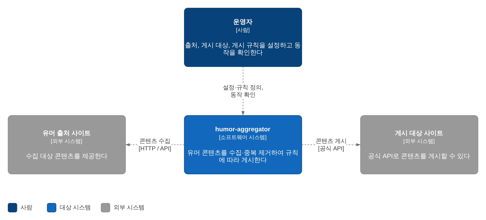
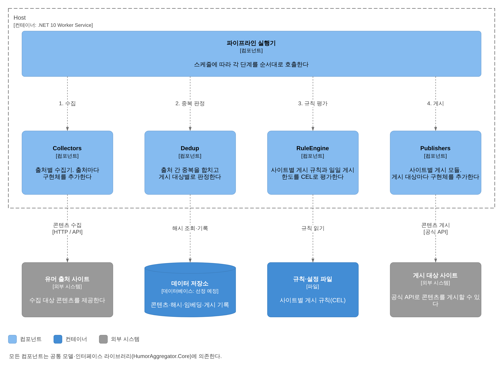
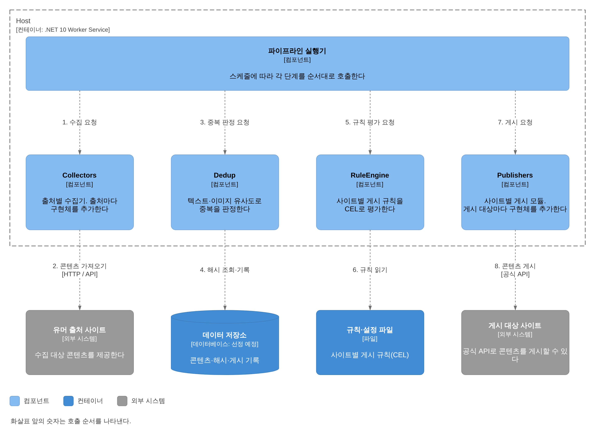

# 아키텍처

[C4 모델](https://c4model.com)의 세 단계(시스템 컨텍스트 → 컨테이너 → 컴포넌트)와 동적 다이어그램으로 문서화합니다. 코드 수준(4단계)은 소스 코드가 그 역할을 하므로 별도 다이어그램을 두지 않습니다. 다이어그램 원본(`.drawio`)은 [`diagrams/`](diagrams/)에 있습니다.

## 1. 시스템 컨텍스트

humor-aggregator는 유머 출처 사이트에서 콘텐츠를 수집하고, 중복을 제거한 뒤, 게시 규칙에 맞춰 게시 대상 사이트에 올립니다. 운영자는 출처·게시 대상·규칙을 설정하고 동작을 확인합니다.

| 구성 요소 | 설명 |
|---|---|
| 운영자 | 시스템을 설정하고 운영하는 사람 |
| 유머 출처 사이트 | 수집 대상 콘텐츠를 제공하는 외부 사이트 |
| 게시 대상 사이트 | 공식 API로 콘텐츠를 게시할 수 있는 외부 사이트 |

## 2. 컨테이너

| 컨테이너 | 기술 | 역할 |
|---|---|---|
| Host | .NET 10 Worker Service | 수집 → 중복 제거 → 규칙 평가 → 게시 파이프라인을 실행하고 스케줄링 |
| 규칙·설정 파일 | 파일 | 출처, 게시 대상, 사이트별 게시 규칙(CEL) 정의 |
| 데이터 저장소 | 선정 예정 | 수집 콘텐츠, 중복 판정용 해시, 게시 기록 보관 |

## 3. 컴포넌트 (Host)

파이프라인 실행기가 스케줄에 따라 네 단계를 순서대로 호출합니다. 각 컴포넌트는 별도 .NET 프로젝트이며, 모두 공통 모델·인터페이스 라이브러리인 `Core`에 의존합니다.

| 컴포넌트 | 프로젝트 | 역할 |
|---|---|---|
| 파이프라인 실행기 | `HumorAggregator.Host` | 단계 호출, 스케줄링, 로깅 |
| Collectors | `HumorAggregator.Collectors` | 출처별 수집기. 출처마다 구현체를 추가 |
| Dedup | `HumorAggregator.Dedup` | 텍스트·이미지 유사도 기반 중복 판정 |
| RuleEngine | `HumorAggregator.RuleEngine` | 사이트별 게시 규칙을 CEL로 평가 |
| Publishers | `HumorAggregator.Publishers` | 사이트별 게시 모듈. 게시 대상마다 구현체를 추가 |
| (공통) | `HumorAggregator.Core` | 공통 모델(`HumorItem` 등)과 인터페이스(`ICollector`, `IDedupService`, `IRuleEngine`, `IPublisher`) |

단위 테스트는 `HumorAggregator.Tests`(xUnit)에 있습니다.

## 4. 동적: 파이프라인 1회 실행

스케줄에 따라 파이프라인이 한 번 실행될 때의 정상 경로입니다. 숫자는 호출 순서입니다.

1. 파이프라인 실행기가 Collectors에 수집을 요청합니다.
2. Collectors가 출처 사이트에서 콘텐츠를 가져옵니다.
3. 실행기가 Dedup에 중복 판정을 요청합니다.
4. Dedup이 데이터 저장소에서 기존 해시를 조회하고, 신규 콘텐츠의 해시를 기록합니다.
5. 실행기가 RuleEngine에 신규 콘텐츠의 규칙 평가를 요청합니다.
6. RuleEngine이 규칙·설정 파일에서 사이트별 게시 규칙을 읽어 평가합니다.
7. 실행기가 규칙을 통과한 콘텐츠의 게시를 Publishers에 요청합니다.
8. Publishers가 게시 대상 사이트의 공식 API로 콘텐츠를 게시합니다.

## 설계 결정

- **규칙 표현: [CEL](https://github.com/google/cel-spec)** — 사이트마다 다른 게시 규칙을 코드 변경 없이 정의할 수 있고, 평가 범위가 제한되어 임의 코드 실행 위험이 없습니다.
- **게시 방식: 각 사이트의 공식 API 우선** — 브라우저 자동화를 쓰지 않으므로 실행 환경이 가볍습니다. 첫 번째 대상은 네이버 카페 Open API(OAuth 2.0)입니다.
- **확장 지점: 플러그인 구조** — 새 출처와 새 게시 대상은 `Collectors`, `Publishers`에 구현체를 추가하는 방식으로 확장합니다.

## 배포

- Docker Compose로 `Host` 컨테이너를 셀프호스팅합니다.
- Terraform으로 OCI 인프라를 프로비저닝합니다.
- GitHub Actions로 빌드·테스트·배포합니다.
