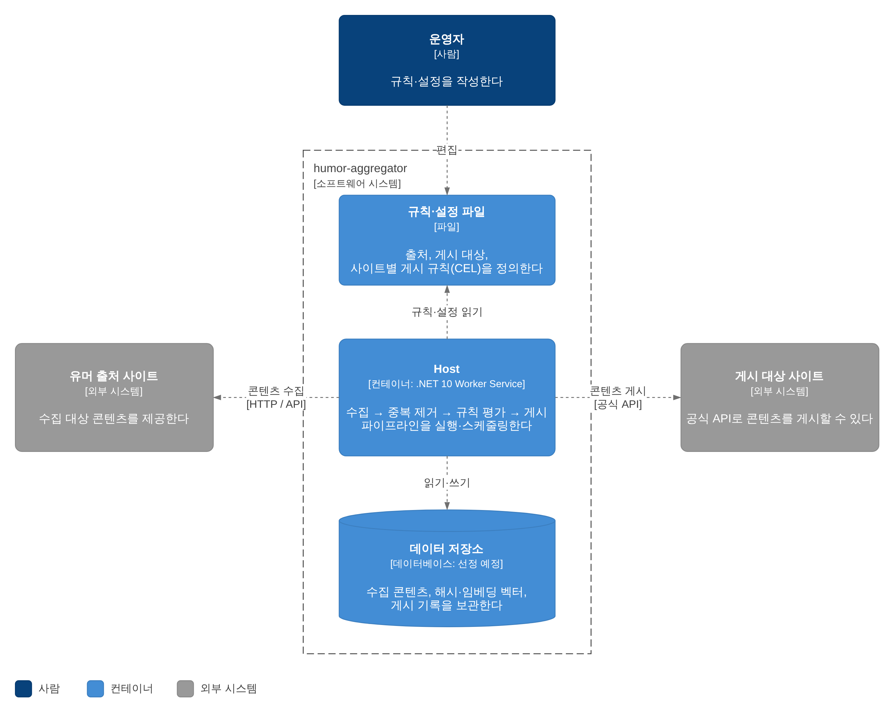

# 아키텍처

[C4 모델](https://c4model.com)의 세 단계(시스템 컨텍스트 → 컨테이너 → 컴포넌트)와 동적 다이어그램으로 문서화합니다. 코드 수준(4단계)은 소스 코드가 그 역할을 하므로 별도 다이어그램을 두지 않습니다. 다이어그램 원본은 [`diagrams/architecture.drawio`](diagrams/architecture.drawio)(4페이지)에 있습니다.

## 1. 시스템 컨텍스트

humor-aggregator는 유머 출처 사이트에서 콘텐츠를 수집하고, 중복을 제거한 뒤, 게시 규칙에 맞춰 게시 대상 사이트에 올립니다. 운영자는 출처·게시 대상·규칙을 설정하고 동작을 확인합니다.

| 구성 요소 | 설명 |
|---|---|
| 운영자 | 시스템을 설정하고 운영하는 사람 |
| 유머 출처 사이트 | 수집 대상 콘텐츠를 제공하는 외부 사이트 |
| 게시 대상 사이트 | 공식 API로 콘텐츠를 게시할 수 있는 외부 사이트 |

## 2. 컨테이너

| 컨테이너 | 기술 | 역할 |
|---|---|---|
| Host | .NET 10 Worker Service | 수집 → 중복 제거 → 규칙 평가 → 게시 파이프라인을 실행하고 스케줄링 |
| 규칙·설정 파일 | 파일 | 출처, 게시 대상, 사이트별 게시 규칙(CEL) 정의 |
| 데이터 저장소 | 선정 예정 | 수집 콘텐츠, 해시·임베딩 벡터, 게시 기록 보관 |

## 3. 컴포넌트 (Host)

파이프라인 실행기가 스케줄에 따라 네 단계를 순서대로 호출합니다. 각 컴포넌트는 별도 .NET 프로젝트이며, 모두 공통 모델·인터페이스 라이브러리인 `Core`에 의존합니다.

| 컴포넌트 | 프로젝트 | 역할 |
|---|---|---|
| 파이프라인 실행기 | `HumorAggregator.Host` | 단계 호출, 스케줄링, 로깅 |
| Collectors | `HumorAggregator.Collectors` | 출처별 수집기. 출처마다 구현체를 추가 |
| Dedup | `HumorAggregator.Dedup` | 출처 간 중복 콘텐츠를 하나로 합치고, 게시 대상별 중복을 판정 |
| RuleEngine | `HumorAggregator.RuleEngine` | 사이트별 게시 규칙과 일일 게시 한도를 CEL로 평가 |
| Publishers | `HumorAggregator.Publishers` | 사이트별 게시 모듈. 게시 대상마다 구현체를 추가 |
| (공통) | `HumorAggregator.Core` | 공통 모델(`HumorItem` 등)과 인터페이스(`ICollector`, `IDedupService`, `IRuleEngine`, `IPublisher`) |

단위 테스트는 `HumorAggregator.Tests`(xUnit)에 있습니다.

## 4. 동적: 파이프라인 1회 실행

스케줄에 따라 파이프라인이 한 번 실행될 때의 정상 경로입니다. 숫자는 호출 순서입니다.

1. 파이프라인 실행기가 Collectors에 수집을 요청합니다.
2. Collectors가 출처 사이트에서 콘텐츠를 가져옵니다.
3. 실행기가 Dedup에 중복 판정을 요청합니다. Dedup은 여러 출처에서 수집된 같은 콘텐츠를 하나로 합칩니다.
4. Dedup이 데이터 저장소에서 기존 해시·임베딩 벡터와 게시 대상별 게시 기록을 조회하고, 신규 콘텐츠의 해시와 임베딩 벡터를 기록합니다.
5. 실행기가 RuleEngine에 신규 콘텐츠의 규칙 평가를 요청합니다. 이때 오늘의 게시 건수를 평가 입력으로 함께 전달합니다.
6. RuleEngine이 규칙·설정 파일에서 사이트별 게시 규칙과 한도를 읽어, 게시할 콘텐츠를 선별합니다.
7. 실행기가 규칙을 통과한 콘텐츠의 게시를 Publishers에 요청합니다.
8. Publishers가 게시 대상 사이트의 공식 API로 콘텐츠를 게시합니다.

## 중복 평가 방식

비용이 낮은 방법부터 순서대로 적용하고, 앞 단계에서 판정되면 뒤 단계는 건너뜁니다.

1. **정확 일치** — YouTube 영상 ID, 정규화한 원본 링크, 이미지 파일 해시가 같으면 중복입니다.
2. **근접 일치** — 이미지 지각 해시와 텍스트 지문으로 크기 조절, 재압축, 워터마크 같은 단순 변형을 잡습니다.
3. **의미 유사도** — 이미지와 텍스트를 멀티모달 임베딩 벡터로 바꿔 코사인 유사도를 비교합니다. 영상은 내려받거나 분석하지 않고 YouTube 영상 ID가 같은지만 비교하며, 임베딩은 이미지와 본문 텍스트에만 사용합니다. 이미지와 텍스트 점수가 모두 임계값을 넘을 때만 중복으로 봅니다. 같은 이미지 틀에 다른 문구를 쓴 유머를 같은 글로 합치지 않기 위해서입니다. 판단이 애매한 구간은 중복으로 보지 않고 근거를 로그에 남깁니다.
4. **병합** — 중복으로 판정된 콘텐츠 중 먼저 수집된 것을 대표로 삼고, 나머지는 내부 수집 기록에만 남깁니다. 게시글에는 출처를 표기하지 않습니다.

**임베딩은 입력당 한 번만 계산합니다.**

- 이미지는 이미지 해시, 텍스트는 정규화한 텍스트 해시를 키로 삼아 벡터를 모델 버전과 함께 저장하고, 이후의 모든 비교는 저장된 벡터로 합니다. 과거에 게시한 콘텐츠를 다시 임베딩하지 않으며, 같은 이미지가 다른 글에 쓰여도 벡터를 재사용합니다.
- 임베딩을 호출하기 전에 걸러냅니다. 정확·근접 일치로 이미 중복이 확정된 콘텐츠, 이미 처리한 콘텐츠를 다시 수집한 경우, 가장 긴 신선도 허용 시간을 넘긴 콘텐츠는 임베딩하지 않습니다.
- 호출은 입력 키 기준으로 멱등하게 처리해, 실패한 입력만 다시 시도하고 성공한 결과는 즉시 저장합니다. 여러 입력은 모아서 한 번에 호출합니다.
- 모델이 다르면 벡터를 서로 비교할 수 없으므로 모델 버전은 고정하고 교체는 신중히 결정합니다. Matryoshka 방식의 모델은 가장 큰 차원으로 저장해 두면 차원을 줄여 쓸 때 다시 임베딩할 필요가 없습니다.

비교 범위는 단계에 따라 다릅니다. 출처 간 병합은 신선도 규칙 안에 드는 최근 수집분과 비교하고, 게시 대상별 판정은 해당 대상의 게시 기록과 비교합니다. 벡터 저장소는 인터페이스로 분리해 처음에는 전수 비교로 구현합니다. 대상별 기록이 수만 건 규모까지는 후보 1건당 비교 시간이 수 ms 수준이라 벡터 인덱스의 이점이 작고, 근사 검색은 중복을 놓칠 수 있기 때문입니다. 벡터가 수십만 건을 넘거나 선택한 데이터베이스가 벡터 인덱스를 제공하면 구현을 교체합니다. 임베딩 공급자도 교체 가능한 인터페이스로 두며, 모델과 임계값은 실제 수집 데이터로 측정해 정합니다.

## 설계 결정

- **규칙 표현: [CEL](https://github.com/google/cel-spec)** — 사이트마다 다른 게시 규칙을 코드 변경 없이 정의할 수 있고, 평가 범위가 제한되어 임의 코드 실행 위험이 없습니다.
- **게시 방식: 각 사이트의 공식 API만 사용** — 브라우저 자동화나 스크래핑은 사용하지 않습니다. 네이버는 공식 API를 통한 접근만 자동화 허용 범위로 두고 있습니다. 첫 번째 대상은 네이버 카페 Open API(OAuth 2.0)입니다.
- **게시 한도 관리** — 게시 대상 사이트가 계정 단위로 걸어 두는 일일 한도(네이버 카페는 계정당 하루 200건, 모든 카페 합산)와 사이트별 상한, 최소 게시 간격을 규칙으로 정의합니다. 게시 후보가 한도보다 많으면 우선순위로 선별하고, 실제 게시량을 기록해 한도 조정의 근거로 삼습니다.
- **중복 판정은 두 단계** — 먼저 **출처 간 중복**을 합칩니다. 여러 출처에서 수집된 같은 콘텐츠는 YouTube 영상 ID, 원본 링크, 이미지·텍스트 유사도로 판별해 하나의 콘텐츠로 묶습니다. 어느 출처에서 발견되었는지는 내부 기록으로만 남기며 게시글에는 표기하지 않습니다. 같은 콘텐츠는 먼저 수집된 쪽을 대표로 삼습니다. 그다음 **게시 대상별 중복**을 판정합니다. 같은 콘텐츠를 서로 다른 게시 대상에는 올릴 수 있지만 같은 게시 대상에는 한 번만 올리며, 봇이 올린 글의 기록과 비교합니다. 게시 대상 사이트에 이미 있는 글(다른 회원이 올린 글 포함)은 확인하지 않습니다. 공식 조회 API가 없고 자동 수집은 이용약관상 허용되지 않기 때문입니다.
- **신선도 규칙** — 출처에 게시된 지 일정 시간 이내의 콘텐츠만 게시 후보로 삼아, 이미 올라와 있을 가능성을 낮춥니다. 허용 시간은 규칙(CEL)의 설정값이며, 이를 위해 수집 시 출처의 게시 시각을 함께 기록합니다. 여러 출처에서 합쳐진 콘텐츠는 가장 이른 게시 시각을 기준으로 판단합니다.
- **임베딩 모델 라이선스** — 모델 가중치는 저장소에 포함하지 않습니다. 공급자마다 라이선스가 다르며 일부 모델은 비상업 이용만 허용하므로, 사용하는 모델의 라이선스는 사용자가 확인하고 따라야 합니다.
- **확장 지점: 플러그인 구조** — 새 출처와 새 게시 대상은 `Collectors`, `Publishers`에 구현체를 추가하는 방식으로 확장합니다.

## 배포

- Docker Compose로 `Host` 컨테이너를 셀프호스팅합니다.
- Terraform으로 OCI 인프라를 프로비저닝합니다.
- GitHub Actions로 빌드·테스트·배포합니다.
